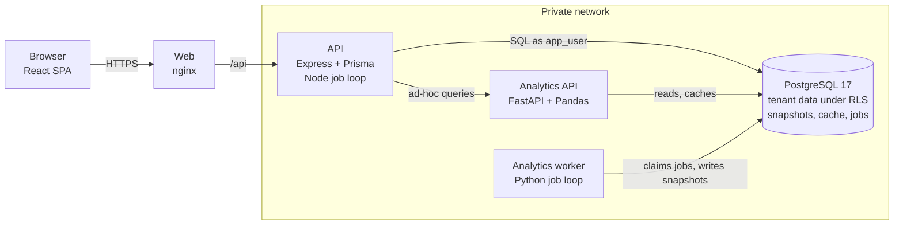

# Customer Insights

Customer analytics for small and medium-sized businesses. Upload your customers and orders, and
get documented metrics you can act on: revenue trends, retention, churn, cohorts, RFM segments,
customer lifetime value, and rule-based recommendations that name the customers they affect.

It is multi-tenant: many businesses share one deployment, and PostgreSQL row-level security makes
sure none of them can ever read another's data.

## Features

- **Business overview:** KPIs and trends for any date range, in the business's own time zone and
  currency, with the current partial period marked as such.
- **Customers:** search, profiles, CSV import with column mapping and a validation preview, and
  one-click demo data.
- **Behavior:** retention curves, churn, cohort heatmaps, purchase frequency and time to second
  purchase.
- **Value:** RFM segmentation with editable, versioned segment rules, and customer lifetime value.
- **Recommendations:** six explainable rules (for example high-value churn risk and the
  second-purchase window), each with its evidence and the list of affected customers.
- **Reports:** PDF reports, CSV exports and a full organization export (ZIP).
- **Teams:** owners, admins, analysts and viewers, with invitations and an audit log.
- **Methodology:** every metric's definition and version, shown in the app next to the number.

## Architecture



| Component        | Path                 | Stack                                                 |
| ---------------- | -------------------- | ----------------------------------------------------- |
| Web app          | `apps/web`           | React 19, TypeScript, Tailwind CSS 4, ECharts 6, Vite |
| API + Node jobs  | `apps/api`           | Node.js 24, Express 5, TypeScript, Prisma 7           |
| Analytics        | `services/analytics` | Python 3.13, FastAPI (internal only), Pandas, NumPy   |
| Shared contracts | `packages/contracts` | Zod schemas used by both the API and the web app      |
| Database         | PostgreSQL 17        | Tenant data, analytics snapshots and the job queue    |

### Key design decisions

Each decision has a short record in [`docs/adr/`](docs/adr/README.md).

- **Modular monolith plus one Python service.** The one boundary that matters, business logic
  versus metric math, is a process boundary. Everything else stays in one API with clear
  modules. ([ADR-0001](docs/adr/0001-modular-monolith.md),
  [ADR-0002](docs/adr/0002-python-analytics-service.md))
- **Two layers of tenant isolation.** The application filters every query by organization, and
  Postgres row-level security backs it up. The app connects as a non-owner role, and each unit of
  work sets the tenant with a transaction-local `set_config`, so the setting can never leak
  through the connection pool. With no tenant set, queries return nothing.
  ([ADR-0004](docs/adr/0004-tenant-isolation.md))
- **Postgres as the job queue.** Workers claim jobs with `FOR UPDATE SKIP LOCKED`, with retries
  and backoff. No Redis or broker to run. ([ADR-0003](docs/adr/0003-postgres-job-queue.md))
- **Snapshots plus a cache keyed by data version.** Every data change bumps the organization's
  `data_version`. Nightly and on-change runs write snapshots, and ad-hoc answers are cached under
  the version they were computed from, so stale entries are never matched.
  ([ADR-0009](docs/adr/0009-snapshots-and-versioned-cache.md))
- **Shared Zod contracts.** The API validates requests and the web app types its calls with the
  same schemas. Errors use RFC 9457 problem details. ([ADR-0006](docs/adr/0006-rest-contracts-zod.md))
- **Own authentication.** Argon2id passwords, a 15-minute JWT kept in memory, and a rotating
  refresh token in an `httpOnly` cookie with reuse detection and CSRF protection.
  ([ADR-0007](docs/adr/0007-own-auth-jwt.md))
- **Money as integers.** Amounts are stored in ISO 4217 minor units, using one currency table
  shared by TypeScript and Python. ([ADR-0011](docs/adr/0011-currency-minor-units.md))
- **Honest statistics.** Low-sample warnings, Wilson intervals, Kaplan–Meier for time to
  repurchase, and cohorts left empty until complete. See
  [the methodology](docs/05-analytics-methodology.md).

## Quick start (Docker)

Requirements: Docker Desktop, or Docker Engine with Compose v2.22 or later.

```bash
cp .env.example .env
```

```bash
docker compose up --build --watch
```

Then open:

- Web app: http://localhost:5173
- API health: http://localhost:4000/api/v1/health
- API readiness (database, migrations, analytics): http://localhost:4000/api/v1/ready
- Emails (Mailpit): http://localhost:8025

`--watch` syncs source changes into the containers. The `migrate` service applies the Prisma
migrations as the schema owner before the API starts; the API and the analytics service then
connect as `app_user`, which row-level security applies to.

Reset the database with `docker compose down -v`.

### Try it with data

Sign up, open **Customers** and choose **Load demo data** (owners only, on an empty
organization). Or generate import-ready CSV files with known ground truth:

```bash
docker compose exec analytics python -m insights.datagen --customers 2000 --industry retail --currency USD --timezone America/Bogota --out /tmp/demo
```

### Run the production build locally

```bash
docker compose -f docker-compose.prod.yml up --build
```

Open http://localhost:8080. These are the same non-root images that run on Render.

## Development without Docker for the apps

Run only Postgres in Docker, and the apps on your machine (Node 24, see `.nvmrc`, and
[uv](https://docs.astral.sh/uv/)).

```bash
docker compose up -d db
```

```bash
npm install
```

```bash
npm run db:migrate -w @ci/api
```

```bash
npm run dev:api
```

```bash
npm run dev:web
```

```bash
cd services/analytics && uv sync && uv run uvicorn insights.api.main:app --reload --env-file ../../.env
```

The API and the Prisma CLI read the root `.env`.

## Tests and checks

| What                         | Command                                                                                  |
| ---------------------------- | ---------------------------------------------------------------------------------------- |
| Lint                         | `npm run lint`                                                                           |
| Format check                 | `npm run format:check`                                                                   |
| Type check                   | `npm run typecheck`                                                                      |
| Unit tests (TypeScript)      | `npm test`                                                                               |
| API integration tests        | `npm run test:integration -w @ci/api` (needs Postgres: `docker compose up -d db`)        |
| Build                        | `npm run build`                                                                          |
| Analytics lint, types, tests | `cd services/analytics && uv run ruff check . && uv run mypy && uv run python -m pytest` |

The integration tests run every endpoint as `app_user` against a database built from the
migrations, including a cross-tenant isolation suite. The analytics tests check each metric
against hand-computed fixtures and generated data with known answers.

[CI](.github/workflows/ci.yml) runs all of these, applies the migrations to a clean Postgres,
builds every Docker image and smoke-tests the production stack.

On Windows hosts where Application Control blocks NumPy's native libraries, run the analytics
tests in Linux:

```bash
docker build --target test -t ci-analytics-test services/analytics && docker run --rm ci-analytics-test
```

## Performance

Measured with k6 on the production images, against a tenant with 100,000 customers and 1.2 million
orders:

| Measure                        | p95               |
| ------------------------------ | ----------------- |
| Customer and order requests    | 132–136 ms        |
| Dashboard                      | 29–32 ms          |
| Full organization export (ZIP) | 37 s, flat memory |

Details, the security review and the accessibility checks are in the
[hardening report](docs/09-hardening-report.md).

## Deployment

The app deploys to [Render](https://render.com) from [`render.yaml`](render.yaml): a public web
service (nginx serving the SPA and proxying `/api`), a private API, a private analytics service, a
background analytics worker and managed Postgres. See [docs/08-deployment.md](docs/08-deployment.md).

## Repository layout

```
apps/
  api/                 Express API, Node job worker, Prisma schema and migrations
  web/                 React single-page app
packages/
  contracts/           Shared Zod schemas (the API contract)
services/
  analytics/           Python analytics service, worker and data generator
infra/
  postgres/init/       Database bootstrap (runtime role)
  load/                k6 load test
docs/                  Requirements, architecture, data model, API, methodology, ADRs
```

## Documentation

| Document                                                        | What it covers                                    |
| --------------------------------------------------------------- | ------------------------------------------------- |
| [Requirements](docs/01-srs.md)                                  | Scope, users, functional and quality requirements |
| [Architecture](docs/02-architecture.md)                         | Components, tenancy, analytics execution, flows   |
| [Data model](docs/03-data-model.md)                             | Tables, row-level security, indexes               |
| [API](docs/04-api-spec.md)                                      | Conventions, endpoints, errors, rate limits       |
| [Analytics methodology](docs/05-analytics-methodology.md)       | Every metric's definition                         |
| [Roadmap](docs/06-roadmap.md)                                   | Milestones M0–M9                                  |
| [Challenges and decisions](docs/07-challenges-and-decisions.md) | Risks, mitigations, deferred decisions            |
| [Deployment](docs/08-deployment.md)                             | Render setup, configuration, operations           |
| [Hardening report](docs/09-hardening-report.md)                 | Load, security and accessibility results          |
| [ADRs](docs/adr/README.md)                                      | One record per architectural decision             |
