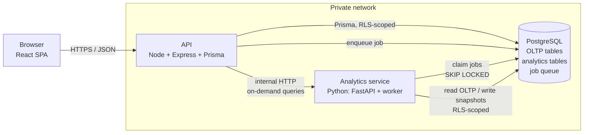

# 02 — System Architecture

## 1. Summary

A **modular monolith** made of four runtime components:

1. **Web** — React SPA (TypeScript, Tailwind, ECharts). Talks only to the API.
2. **API** — Node.js + Express + TypeScript + Prisma. The single public backend: auth, tenancy, validation, CRUD, imports, exports, and serving analytics results.
3. **Analytics service** — Python (Pandas, NumPy, SQL). Owns every metric definition and calculation. Runs batch jobs and answers internal on-demand queries. Not exposed publicly.
4. **PostgreSQL** — system of record for transactional data **and** for analytics outputs (snapshots), plus the job queue.



## 2. Why this shape

| Decision                    | Choice                                                                                                                  | Reasoning                                                                                                                                                                                                      | Alternatives rejected                                                                                                                                                                      |
| --------------------------- | ----------------------------------------------------------------------------------------------------------------------- | -------------------------------------------------------------------------------------------------------------------------------------------------------------------------------------------------------------- | ------------------------------------------------------------------------------------------------------------------------------------------------------------------------------------------ |
| Overall style               | Modular monolith (one API process, one analytics process)                                                               | Two deployables keep the language boundary clean without the cost of microservices (service discovery, distributed transactions, many pipelines). Modules have explicit boundaries so they can be split later. | Microservices (premature), single Node process doing analytics (contradicts the Python requirement and mixes concerns).                                                                    |
| Where analytics runs        | Separate Python service                                                                                                 | The spec requires Pandas/NumPy and requires analytics to be separated from business and presentation logic. A process boundary enforces that separation; it cannot erode through convenience imports.          | Python scripts called by `child_process` (fragile, no pooling), analytics in SQL views only (hard to test, no statistics library).                                                         |
| Node ↔ Python communication | **Two channels**: a Postgres-backed job queue for batch work, internal HTTP (FastAPI) for on-demand queries             | Batch recomputes (RFM, cohorts, recommendations) must survive restarts and retry — a durable queue does that. Ad-hoc filtered queries (arbitrary date range + segment) need a synchronous answer.              | Redis/BullMQ (another service to run; Postgres `SKIP LOCKED` is enough at this scale), message broker (overkill).                                                                          |
| Analytics storage           | Same PostgreSQL, separate `analytics_*` tables                                                                          | No ETL into a warehouse; one backup; joins with customers are easy. At SMB scale Postgres handles it.                                                                                                          | Separate warehouse (ClickHouse/BigQuery) — revisit only if A1 volumes are exceeded by 10x.                                                                                                 |
| Schema ownership            | **Prisma migrations own all tables**, including analytics tables                                                        | One migration history, one source of truth. Python reads/writes with plain SQL (psycopg 3) and never runs migrations.                                                                                          | Alembic for Python tables (two migration tools fighting over one DB).                                                                                                                      |
| Multi-tenancy               | Shared database, shared schema, `organization_id` on every tenant table, enforced by app scoping **and** Postgres RLS   | Cheapest to operate, easy cross-tenant maintenance, and RLS gives a database-level guarantee even if a developer forgets a `where`.                                                                            | Schema-per-tenant (migration fan-out, connection pool issues), DB-per-tenant (expensive for SMB pricing).                                                                                  |
| API style                   | REST + JSON, OpenAPI 3.1 generated from Zod schemas                                                                     | Spec requires REST. Generating OpenAPI from the validation schemas means docs cannot drift from behavior.                                                                                                      | GraphQL (not requested; complicates caching and authorization).                                                                                                                            |
| Auth                        | Own email/password auth with JWT access token (15 min, memory) + rotating refresh token (httpOnly cookie, hashed in DB) | Simple, standard, no vendor lock-in; refresh rotation with reuse detection limits stolen-token damage.                                                                                                         | Auth0/Clerk (fine choice for a product; less instructive for a portfolio; reconsider for [OPEN-12]). Session cookies only (would also work; JWT keeps the API stateless for the hot path). |
| Frontend data layer         | TanStack Query + React Router; Zustand only for UI state                                                                | Server state caching, retries and invalidation for free; avoids a global Redux store.                                                                                                                          | Redux Toolkit (more boilerplate for mostly server state).                                                                                                                                  |
| Repo layout                 | Monorepo with npm workspaces (ADR-0008)                                                                                 | Shared TypeScript types (API contract) between web and API; one CI.                                                                                                                                            | Polyrepo (contract drift).                                                                                                                                                                 |

## 3. Repository layout

```
customer-insights/
├─ apps/
│  ├─ web/                     React SPA (Vite)
│  │  └─ src/
│  │     ├─ app/               router, providers, layout
│  │     ├─ features/          overview/, customers/, segments/, analytics/,
│  │     │                     recommendations/, reports/, imports/, settings/, auth/
│  │     ├─ components/        design system (Button, Card, KpiCard, DataTable, Chart...)
│  │     ├─ lib/               api client (generated types), formatting, date utils
│  │     └─ charts/            ECharts option builders (pure functions, unit-tested)
│  └─ api/                     Express API
│     ├─ prisma/               schema.prisma, migrations/, seed.ts, rls.sql
│     └─ src/
│        ├─ modules/           one folder per bounded module (see §4)
│        │  └─ customers/      customers.routes.ts, .controller.ts, .service.ts,
│        │                     .repository.ts, .schemas.ts (Zod), customers.test.ts
│        ├─ core/              auth, tenancy, errors, validation, logging, config
│        ├─ infra/             prisma client + tenant extension, analytics client, job queue
│        └─ server.ts
├─ services/
│  └─ analytics/               Python package
│     ├─ insights/
│     │  ├─ api/               FastAPI app (internal endpoints)
│     │  ├─ worker/            job loop, job handlers
│     │  ├─ data/              SQL loaders → typed DataFrames, cleaning
│     │  ├─ metrics/           pure functions: overview.py, rfm.py, cohorts.py,
│     │  │                     retention.py, frequency.py, clv.py, engagement.py
│     │  ├─ recommendations/   rules/*.py, engine.py
│     │  ├─ definitions/       metric registry (YAML) — key, version, formula text
│     │  └─ db.py              connection pool, tenant context
│     ├─ tests/                unit tests + golden fixtures
│     └─ pyproject.toml
├─ packages/
│  └─ contracts/               shared Zod schemas + generated OpenAPI + TS types
├─ tools/
│  └─ datagen/                 synthetic data generator (Python) with known ground truth
├─ docs/                       these documents + ADRs
├─ docker-compose.yml
└─ .github/workflows/          CI
```

## 4. Backend modules (API)

Each module owns its routes, validation schemas, service (business rules) and repository (data access). Modules talk to each other through service interfaces, never through another module's repository.

| Module            | Responsibility                                                                               |
| ----------------- | -------------------------------------------------------------------------------------------- |
| `auth`            | Signup, login, refresh, logout, password reset, invitations.                                 |
| `organizations`   | Organization settings, members and roles.                                                    |
| `customers`       | Customer CRUD, search, profile aggregation (calls `analytics` for metrics).                  |
| `orders`          | Order and order-item CRUD. Emits a "data changed" signal.                                    |
| `interactions`    | Interaction CRUD.                                                                            |
| `imports`         | CSV upload, mapping, validation, background processing via the queue.                        |
| `analytics`       | Thin facade: reads snapshot tables or calls the Python service. **Contains no metric math.** |
| `segments`        | Segment configuration CRUD and versioning.                                                   |
| `recommendations` | List, status changes, affected-customer lists.                                               |
| `reports`         | Exports (streamed CSV), comparison reports, PDF job requests.                                |
| `jobs`            | Job enqueue and status.                                                                      |
| `audit`           | Append-only audit log writer.                                                                |

**Layering rule:** `routes → controller (HTTP only) → service (rules, authorization checks) → repository (Prisma)`. Controllers never touch Prisma; repositories never know about HTTP.

## 5. Multi-tenancy and isolation

Two independent layers, so one mistake does not leak data.

**Layer 1 — application scoping.**

- The auth middleware resolves `req.auth = { userId, organizationId, role }` from the access token. The token carries the active organization; the membership and role are re-read from the database on each request (cached for 10 s per process, cleared at once by team changes), so a removed or demoted member loses access within seconds rather than when the token expires.
- The tenant Prisma client is created per request through a Prisma client extension that injects `organizationId` into every `where` and `data` for tenant models. Services cannot obtain an unscoped client; only the `auth` and platform-admin code paths can.
- Lookups by ID always use `{ id, organizationId }`. A record in another tenant returns **404**, not 403, so IDs cannot be probed.

**Layer 2 — PostgreSQL row-level security.**

- Every tenant table has `ENABLE ROW LEVEL SECURITY` and `FORCE ROW LEVEL SECURITY` with a policy `organization_id = current_setting('app.org_id')::uuid`.
- The app connects as a non-owner role (`app_user`), which is subject to RLS. Migrations run as the owner role.
- The Prisma extension wraps each request's queries in a transaction that first runs `SELECT set_config('app.org_id', $1, true)` (transaction-local, safe with connection pooling). The Python service does the same per job/request.
- If `app.org_id` is not set, the policy matches nothing, so the failure mode is "no data", never "all data".

**Cost and mitigation:** wrapping queries in a transaction adds a round trip. Acceptable at this scale; batched where it matters. The decision is recorded as an ADR and covered by a cross-tenant test suite (M1) that runs against every endpoint.

## 6. Analytics layer design

### 6.1 Responsibilities

- Load transactional data for one tenant (SQL with aggregations pushed down where possible).
- Clean and validate it (data-quality report: missing customer, negative amounts, future dates, duplicates).
- Compute metrics as **pure functions**: `DataFrame(s) + params → result`. No I/O inside metric functions, so they are easy to unit-test with small fixtures.
- Persist snapshots with definition versions.
- Run the recommendation rules on the fresh snapshot.

### 6.2 Execution modes

| Mode                | Trigger                                                                                                                                          | Used for                                                                | Output                                                                                               |
| ------------------- | ------------------------------------------------------------------------------------------------------------------------------------------------ | ----------------------------------------------------------------------- | ---------------------------------------------------------------------------------------------------- |
| **Batch snapshot**  | Nightly schedule per tenant (in the tenant's time zone, 02:00), after an import completes, after data changes (debounced 10 min), or "Recompute" | Customer metrics, RFM, cohorts, monthly retention, CLV, recommendations | `analytics_*` tables                                                                                 |
| **On-demand query** | API call with arbitrary filters                                                                                                                  | Overview for a custom range, segment-filtered views, period comparison  | JSON response, cached in `analytics_query_cache` keyed by `(org, metric, params_hash, data_version)` |

`organizations.data_version` is incremented whenever tenant data changes (orders, customers, imports). Cache entries with an older `data_version` are ignored, so invalidation is trivial and correct.

### 6.3 Job queue

- Table `jobs(id, organization_id, type, payload, status, attempts, run_after, locked_at, locked_by, error, created_at, finished_at)`.
- Worker claims with `SELECT … FOR UPDATE SKIP LOCKED LIMIT 1`, runs, marks `succeeded` or `failed`; retries with exponential backoff up to 3 attempts; stale locks (> 15 min) are reclaimed.
- Deduplication: at most one pending `analytics.recompute` per organization (partial unique index).
- Import jobs are processed by the **Node** worker (same queue, different `type` prefix), because validation rules live in the API's Zod schemas. Analytics jobs are processed by Python.

### 6.4 Why not compute everything in SQL?

Simple aggregates (counts, sums, `date_trunc` buckets) **are** pushed into SQL, which shows SQL aggregation skills and keeps data transfer small. Pandas is used where it is clearer or needed: quantile scoring with tie handling, cohort pivoting, distributions, statistical tests, and rule evaluation. Each metric module documents which part runs where.

## 7. Request flows

### 7.1 Dashboard load (cached snapshot path)

1. `GET /api/v1/analytics/overview?start=…&end=…` → auth → tenant context.
2. `analytics` module checks `analytics_query_cache` for `(org, overview, params_hash, data_version)`.
3. On miss: POST to `analytics:8000/internal/overview` with `organization_id` and params (service-to-service token).
4. Python computes, stores the cache row, returns JSON including definition metadata.
5. API returns the response; the web app renders KPI cards and charts.

### 7.2 CSV import

1. Upload → stored in an `imports` row (file kept in local volume / object storage) → status `uploaded`.
2. User confirms the column mapping → validation job runs → preview of errors.
3. User commits → import job upserts in batches of 1,000 inside transactions, writes a row-level error file → bumps `data_version` → enqueues `analytics.recompute`.

## 8. Cross-cutting concerns

- **Validation:** Zod schemas in `packages/contracts`, used by the API (request validation) and the web app (forms). Python uses Pydantic for its internal API.
- **Errors:** one error shape (RFC 9457 problem details, see [04-api-spec.md](04-api-spec.md) §1.5). Domain errors are typed classes mapped to HTTP status codes in one middleware. Unexpected errors are logged with a request ID and returned as a generic 500.
- **Logging:** pino (API) and structlog (Python), JSON, with `request_id` and `organization_id`, no personal data.
- **Configuration:** environment variables validated at startup (Zod / pydantic-settings). The app refuses to start with invalid config.
- **Time:** all storage in UTC; all period logic receives the organization time zone explicitly. A shared test suite checks DST boundaries.
- **Security headers / CORS / rate limits:** Helmet, an explicit origin allow-list, `express-rate-limit` backed by Postgres or memory per instance.

## 9. Deployment (Docker)

`docker-compose.yml` services for local development:

| Service      | Image             | Notes                                                                         |
| ------------ | ----------------- | ----------------------------------------------------------------------------- |
| `db`         | postgres:17       | Volume; init script creates `app_user` role.                                  |
| `api`        | node:24 build     | Runs migrations on start (dev only), hot reload.                              |
| `api-worker` | same image as api | Runs the Node job worker (imports, exports).                                  |
| `analytics`  | python:3.13 build | FastAPI (internal) and the analytics worker as two processes or two services. |
| `web`        | node:24 build     | Vite dev server; in production, static files served by nginx/CDN.             |
| `mailpit`    | axllent/mailpit   | Local email capture (P1).                                                     |

Production (M9): Render, from `render.yaml`. Only the web service is public. Its nginx serves the SPA and proxies `/api` to the private API service, which runs the Node job loop in-process (single disk for uploads and reports). The analytics service and worker are private, and Postgres is managed. The production images are non-root and the default build target; `docker-compose.prod.yml` runs them locally the same way. See [08-deployment.md](08-deployment.md).

## 10. Testing strategy (overview)

| Layer                | Tooling                                            | Focus                                                                                                                 |
| -------------------- | -------------------------------------------------- | --------------------------------------------------------------------------------------------------------------------- |
| Analytics metrics    | pytest + hypothesis                                | Hand-computed golden fixtures for every metric; property tests (e.g. retention ∈ [0,1], segment counts sum to total). |
| Analytics end-to-end | pytest + Testcontainers Postgres                   | Generated dataset with known ground truth → snapshot → assertions.                                                    |
| API                  | Vitest + Supertest + Testcontainers Postgres       | Endpoint behavior, validation, authorization matrix, **cross-tenant isolation suite**.                                |
| Web                  | Vitest + React Testing Library; Playwright for E2E | Components, chart option builders, critical user journeys.                                                            |
| Contract             | OpenAPI diff in CI                                 | Breaking-change detection.                                                                                            |

## 11. Architecture Decision Records

Each decision in §2 will be recorded as a short ADR in `docs/adr/` during M0 (context, decision, consequences). Additional decisions and risks are in [07-challenges-and-decisions.md](07-challenges-and-decisions.md).
