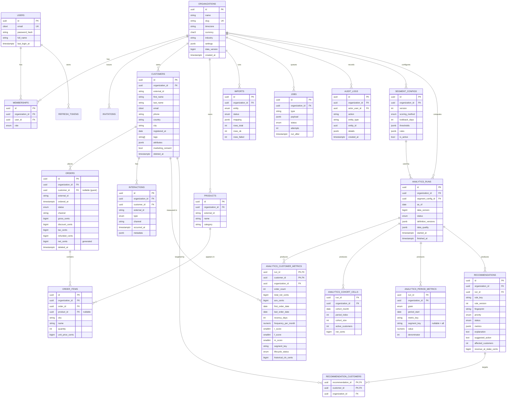

# 03 — Data Model: ERD and Database Schema

## 1. Design principles

1. **Every tenant-owned row carries `organization_id`** (UUID), even when it could be derived through a parent (for example `order_items`). This allows RLS on every table without joins and makes composite indexes start with the tenant.
2. **UUID v7 primary keys** (time-ordered, so B-tree inserts stay local). Generated in the application.
3. **External IDs** (`external_id`) from the tenant's source systems are unique per organization and make imports idempotent.
4. **Money as `BIGINT` minor units** (`amount_cents`). Never floating point.
5. **Timestamps as `timestamptz` in UTC.** Business dates are derived using the organization time zone.
6. **Soft delete** (`deleted_at`) for customers and orders so accidental deletes are recoverable. Analytics exclude soft-deleted rows. Erasure (CUS-10) anonymizes instead.
7. **Transactional tables vs analytics tables.** Analytics outputs live in tables prefixed `analytics_`, written only by the Python service, read by the API. They are fully re-computable.
8. **Configuration is versioned** (`segment_configs`) so every snapshot can say which rules produced it.

## 2. Entity Relationship Diagram



### 2.1 Relationship notes

- **Users ↔ Organizations** is many-to-many through `memberships` (a consultant can serve several businesses). Unique `(organization_id, user_id)`.
- **Orders → Customers** is optional: guest orders (`customer_id IS NULL`) count toward revenue but not toward customer metrics ([OPEN-7]).
- **Products** are optional. The platform works with order totals alone; item-level data enables future product affinity analysis.
- **Analytics rows belong to a run.** The "current" view of each table is the latest `succeeded` run for the organization. Old runs are kept for trend and segment-migration analysis, then pruned ([OPEN-11]).
- **Invitations** (M8) store only a token hash, `expires_at` (7 days), `accepted_at` and `revoked_at`; one pending invitation per organization and email. **Password reset tokens** (60 minutes, single use) and `jobs.result` (output of report jobs) were added in the same migration.
- **Recommendations** (M7) also store `missed_runs`, `status_revenue_cents` and `status_changed_at` for the lifecycle, and `recommendation_customers.value_cents` (trailing-12-month spend) to order the affected list. They have a `fingerprint` (`rule_key` + stable parameters, e.g. segment) so a recurring condition updates the existing open recommendation instead of creating duplicates, and a dismissed one stays dismissed (REC-04).

## 3. Prisma schema (proposal)

```prisma
generator client {
  provider        = "prisma-client-js"
  previewFeatures = ["postgresqlExtensions"]
}

datasource db {
  provider   = "postgresql"
  url        = env("DATABASE_URL")
  extensions = [citext]
}

// ───────────── Identity & tenancy ─────────────

enum Role { OWNER ADMIN ANALYST VIEWER }

model Organization {
  id          String   @id @db.Uuid
  name        String
  slug        String   @unique
  timezone    String   @default("UTC")          // IANA name
  currency    String   @db.Char(3)              // ISO-4217
  industry    String?                           // retail | ecommerce | restaurant | subscription | services
  settings    Json     @default("{}")           // activeWindowDays, churnDays, weekStart, ...
  dataVersion BigInt   @default(0) @map("data_version")
  createdAt   DateTime @default(now()) @map("created_at") @db.Timestamptz
  updatedAt   DateTime @updatedAt @map("updated_at") @db.Timestamptz

  memberships Membership[]
  customers   Customer[]
  orders      Order[]
  // ... other relations omitted for brevity
  @@map("organizations")
}

model User {
  id           String    @id @db.Uuid
  email        String    @unique @db.Citext
  passwordHash String    @map("password_hash")
  fullName     String    @map("full_name")
  lastLoginAt  DateTime? @map("last_login_at") @db.Timestamptz
  createdAt    DateTime  @default(now()) @map("created_at") @db.Timestamptz

  memberships   Membership[]
  refreshTokens RefreshToken[]
  @@map("users")
}

model Membership {
  id             String       @id @db.Uuid
  organizationId String       @map("organization_id") @db.Uuid
  userId         String       @map("user_id") @db.Uuid
  role           Role
  createdAt      DateTime     @default(now()) @map("created_at") @db.Timestamptz
  organization   Organization @relation(fields: [organizationId], references: [id], onDelete: Cascade)
  user           User         @relation(fields: [userId], references: [id], onDelete: Cascade)

  @@unique([organizationId, userId])
  @@index([userId])
  @@map("memberships")
}

model RefreshToken {
  id         String    @id @db.Uuid
  userId     String    @map("user_id") @db.Uuid
  organizationId String @map("organization_id") @db.Uuid // active org; reissued access tokens keep it
  familyId   String    @map("family_id") @db.Uuid   // rotation chain; reuse revokes the family
  tokenHash  String    @unique @map("token_hash")   // SHA-256 of the opaque token
  expiresAt  DateTime  @map("expires_at") @db.Timestamptz
  revokedAt  DateTime? @map("revoked_at") @db.Timestamptz
  replacedBy String?   @map("replaced_by") @db.Uuid
  createdAt  DateTime  @default(now()) @map("created_at") @db.Timestamptz
  user       User      @relation(fields: [userId], references: [id], onDelete: Cascade)

  @@index([userId])
  @@index([familyId])
  @@map("refresh_tokens")
}

model Invitation {
  id             String    @id @db.Uuid
  organizationId String    @map("organization_id") @db.Uuid
  email          String    @db.Citext
  role           Role
  tokenHash      String    @unique @map("token_hash")
  expiresAt      DateTime  @map("expires_at") @db.Timestamptz
  acceptedAt     DateTime? @map("accepted_at") @db.Timestamptz
  invitedById    String    @map("invited_by_id") @db.Uuid
  @@index([organizationId])
  @@map("invitations")
}

// ───────────── Customer data ─────────────

model Customer {
  id               String    @id @db.Uuid
  organizationId   String    @map("organization_id") @db.Uuid
  externalId       String?   @map("external_id")
  firstName        String?   @map("first_name")
  lastName         String?   @map("last_name")
  email            String?   @db.Citext
  phone            String?
  country          String?   @db.Char(2)            // ISO-3166 alpha-2
  region           String?
  city             String?
  registeredAt     DateTime? @map("registered_at") @db.Date
  tags             String[]  @default([])
  attributes       Json      @default("{}")
  marketingConsent Boolean   @default(false) @map("marketing_consent")
  anonymizedAt     DateTime? @map("anonymized_at") @db.Timestamptz
  deletedAt        DateTime? @map("deleted_at") @db.Timestamptz
  createdAt        DateTime  @default(now()) @map("created_at") @db.Timestamptz
  updatedAt        DateTime  @updatedAt @map("updated_at") @db.Timestamptz

  organization Organization  @relation(fields: [organizationId], references: [id], onDelete: Cascade)
  orders       Order[]
  interactions Interaction[]

  @@unique([organizationId, externalId])
  @@index([organizationId, email])
  @@index([organizationId, createdAt])
  @@map("customers")
}

enum OrderStatus { PENDING COMPLETED PARTIALLY_REFUNDED REFUNDED CANCELLED }

model Order {
  id             String      @id @db.Uuid
  organizationId String      @map("organization_id") @db.Uuid
  customerId     String?     @map("customer_id") @db.Uuid
  externalId     String?     @map("external_id")
  orderedAt      DateTime    @map("ordered_at") @db.Timestamptz
  status         OrderStatus @default(COMPLETED)
  channel        String?                                   // online | in_store | phone | marketplace ...
  grossCents     BigInt      @map("gross_cents")
  discountCents  BigInt      @default(0) @map("discount_cents")
  taxCents       BigInt      @default(0) @map("tax_cents")
  refundedCents  BigInt      @default(0) @map("refunded_cents")
  // net_cents is a GENERATED column added in raw SQL migration:
  //   gross_cents - discount_cents - refunded_cents   (tax excluded, see OPEN-3)
  deletedAt      DateTime?   @map("deleted_at") @db.Timestamptz
  createdAt      DateTime    @default(now()) @map("created_at") @db.Timestamptz
  updatedAt      DateTime    @updatedAt @map("updated_at") @db.Timestamptz

  organization Organization @relation(fields: [organizationId], references: [id], onDelete: Cascade)
  customer     Customer?    @relation(fields: [customerId], references: [id], onDelete: SetNull)
  items        OrderItem[]

  @@unique([organizationId, externalId])
  @@index([organizationId, orderedAt])
  @@index([organizationId, customerId, orderedAt])
  @@map("orders")
}

model OrderItem {
  id             String   @id @db.Uuid
  organizationId String   @map("organization_id") @db.Uuid
  orderId        String   @map("order_id") @db.Uuid
  productId      String?  @map("product_id") @db.Uuid
  sku            String?
  name           String
  quantity       Int
  unitPriceCents BigInt   @map("unit_price_cents")
  order          Order    @relation(fields: [orderId], references: [id], onDelete: Cascade)
  product        Product? @relation(fields: [productId], references: [id], onDelete: SetNull)

  @@index([organizationId, orderId])
  @@index([organizationId, productId])
  @@map("order_items")
}

model Product {
  id             String      @id @db.Uuid
  organizationId String      @map("organization_id") @db.Uuid
  externalId     String?     @map("external_id")
  name           String
  category       String?
  items          OrderItem[]
  @@unique([organizationId, externalId])
  @@map("products")
}

enum InteractionType {
  WEBSITE_VISIT EMAIL_SENT EMAIL_OPENED EMAIL_CLICKED
  SUPPORT_TICKET REVIEW LOYALTY_SIGNUP CAMPAIGN_RESPONSE OTHER
}

model Interaction {
  id             String          @id @db.Uuid
  organizationId String          @map("organization_id") @db.Uuid
  customerId     String          @map("customer_id") @db.Uuid
  type           InteractionType
  channel        String?
  occurredAt     DateTime        @map("occurred_at") @db.Timestamptz
  metadata       Json            @default("{}")
  customer       Customer        @relation(fields: [customerId], references: [id], onDelete: Cascade)

  @@index([organizationId, customerId, occurredAt])
  @@index([organizationId, type, occurredAt])
  @@map("interactions")
}

// ───────────── Operations ─────────────

enum ImportEntity { CUSTOMERS ORDERS ORDER_ITEMS INTERACTIONS }
enum ImportStatus { UPLOADED MAPPED VALIDATING VALIDATED IMPORTING COMPLETED FAILED }

model Import {
  id             String       @id @db.Uuid
  organizationId String       @map("organization_id") @db.Uuid
  entity         ImportEntity
  status         ImportStatus @default(UPLOADED)
  fileKey        String       @map("file_key")
  originalName   String       @map("original_name")
  mapping        Json?
  rowsTotal      Int          @default(0) @map("rows_total")
  rowsOk         Int          @default(0) @map("rows_ok")
  rowsFailed     Int          @default(0) @map("rows_failed")
  errorFileKey   String?      @map("error_file_key")
  createdById    String       @map("created_by_id") @db.Uuid
  createdAt      DateTime     @default(now()) @map("created_at") @db.Timestamptz
  finishedAt     DateTime?    @map("finished_at") @db.Timestamptz
  @@index([organizationId, createdAt])
  @@map("imports")
}

enum JobStatus { PENDING RUNNING SUCCEEDED FAILED }

model Job {
  id             String    @id @db.Uuid
  organizationId String?   @map("organization_id") @db.Uuid
  type           String                                   // "import.process" | "analytics.recompute" | "report.pdf" ...
  payload        Json      @default("{}")
  status         JobStatus @default(PENDING)
  attempts       Int       @default(0)
  maxAttempts    Int       @default(3) @map("max_attempts")
  runAfter       DateTime  @default(now()) @map("run_after") @db.Timestamptz
  lockedAt       DateTime? @map("locked_at") @db.Timestamptz
  lockedBy       String?   @map("locked_by")
  error          String?
  createdAt      DateTime  @default(now()) @map("created_at") @db.Timestamptz
  finishedAt     DateTime? @map("finished_at") @db.Timestamptz
  @@index([status, runAfter])
  @@map("jobs")
}

model AuditLog {
  id             String   @id @db.Uuid
  organizationId String   @map("organization_id") @db.Uuid
  actorUserId    String?  @map("actor_user_id") @db.Uuid
  action         String                                   // "customer.delete", "export.customers", ...
  entityType     String?  @map("entity_type")
  entityId       String?  @map("entity_id") @db.Uuid
  details        Json     @default("{}")
  ip             String?
  createdAt      DateTime @default(now()) @map("created_at") @db.Timestamptz
  @@index([organizationId, createdAt])
  @@map("audit_logs")
}

// ───────────── Analytics configuration & outputs ─────────────

enum ScoringMethod { QUINTILE FIXED_THRESHOLDS }

model SegmentConfig {
  id             String        @id @db.Uuid
  organizationId String        @map("organization_id") @db.Uuid
  version        Int
  scoringMethod  ScoringMethod @default(QUINTILE) @map("scoring_method")
  lookbackDays   Int           @default(365) @map("lookback_days")
  thresholds     Json?         // for FIXED_THRESHOLDS: { recency: [..4 cut points], frequency: [...], monetary: [...] }
  rules          Json          // ordered list: [{ key, name, color, description, r: [min,max], f: [min,max], m?: [min,max] }]
  isActive       Boolean       @default(false) @map("is_active")
  createdById    String        @map("created_by_id") @db.Uuid
  createdAt      DateTime      @default(now()) @map("created_at") @db.Timestamptz
  @@unique([organizationId, version])
  @@map("segment_configs")
}

enum RunStatus { RUNNING SUCCEEDED FAILED }

model AnalyticsRun {
  id                 String    @id @db.Uuid
  organizationId     String    @map("organization_id") @db.Uuid
  segmentConfigId    String?   @map("segment_config_id") @db.Uuid
  asOf               DateTime  @map("as_of") @db.Date
  dataVersion        BigInt    @map("data_version")
  status             RunStatus @default(RUNNING)
  definitionVersions Json      @map("definition_versions")   // { "retention_rate": 1, "rfm": 2, ... }
  dataQuality        Json?     @map("data_quality")          // counts of excluded/invalid rows by reason
  stats              Json?                                    // timings, row counts
  error              String?
  startedAt          DateTime  @default(now()) @map("started_at") @db.Timestamptz
  finishedAt         DateTime? @map("finished_at") @db.Timestamptz
  @@index([organizationId, status, asOf(sort: Desc)])
  @@map("analytics_runs")
}

enum LifecycleStatus { PROSPECT ACTIVE AT_RISK CHURNED }  // PROSPECT = no orders yet

model AnalyticsCustomerMetrics {
  runId              String          @map("run_id") @db.Uuid
  customerId         String          @map("customer_id") @db.Uuid
  organizationId     String          @map("organization_id") @db.Uuid
  orderCount         Int             @map("order_count")
  totalNetCents      BigInt          @map("total_net_cents")
  aovCents           BigInt?         @map("aov_cents")
  firstOrderDate     DateTime?       @map("first_order_date") @db.Date
  lastOrderDate      DateTime?       @map("last_order_date") @db.Date
  recencyDays        Int?            @map("recency_days")
  tenureDays         Int?            @map("tenure_days")
  frequencyPerMonth  Decimal?        @map("frequency_per_month") @db.Decimal(10, 4)
  medianGapDays      Decimal?        @map("median_gap_days") @db.Decimal(10, 2)
  rScore             Int?            @map("r_score") @db.SmallInt
  fScore             Int?            @map("f_score") @db.SmallInt
  mScore             Int?            @map("m_score") @db.SmallInt
  segmentKey         String?         @map("segment_key")
  lifecycleStatus    LifecycleStatus @map("lifecycle_status")
  historicalClvCents BigInt          @map("historical_clv_cents")
  engagementScore    Decimal?        @map("engagement_score") @db.Decimal(6, 2)

  @@id([runId, customerId])
  @@index([organizationId, runId, segmentKey])
  @@index([organizationId, customerId])
  @@map("analytics_customer_metrics")
}

enum Grain { DAY WEEK MONTH QUARTER }

model AnalyticsPeriodMetric {
  id             BigInt   @id @default(autoincrement())
  runId          String   @map("run_id") @db.Uuid
  organizationId String   @map("organization_id") @db.Uuid
  grain          Grain
  periodStart    DateTime @map("period_start") @db.Date
  metricKey      String   @map("metric_key")        // "revenue_net", "new_customers", "retention_rate", ...
  segmentKey     String   @default("_all") @map("segment_key")
  value          Decimal  @db.Decimal(20, 6)
  numerator      Decimal? @db.Decimal(20, 6)
  denominator    Decimal? @db.Decimal(20, 6)
  @@unique([runId, grain, periodStart, metricKey, segmentKey])
  @@index([organizationId, metricKey, grain, periodStart])
  @@map("analytics_period_metrics")
}

model AnalyticsCohortCell {
  id               BigInt   @id @default(autoincrement())
  runId            String   @map("run_id") @db.Uuid
  organizationId   String   @map("organization_id") @db.Uuid
  cohortMonth      DateTime @map("cohort_month") @db.Date
  periodIndex      Int      @map("period_index")        // 0 = acquisition month
  cohortSize       Int      @map("cohort_size")
  activeCustomers  Int      @map("active_customers")
  netCents         BigInt   @map("net_cents")
  @@unique([runId, cohortMonth, periodIndex])
  @@map("analytics_cohort_cells")
}

model AnalyticsQueryCache {
  organizationId String   @map("organization_id") @db.Uuid
  metric         String
  paramsHash     String   @map("params_hash")
  dataVersion    BigInt   @map("data_version")
  result         Json
  createdAt      DateTime @default(now()) @map("created_at") @db.Timestamptz
  @@id([organizationId, metric, paramsHash, dataVersion])
  @@map("analytics_query_cache")
}

enum Priority { HIGH MEDIUM LOW }
enum RecommendationStatus { OPEN ACKNOWLEDGED DONE DISMISSED EXPIRED }

model Recommendation {
  id                  String               @id @db.Uuid
  organizationId      String               @map("organization_id") @db.Uuid
  runId               String               @map("run_id") @db.Uuid     // last run that confirmed it
  ruleKey             String               @map("rule_key")
  ruleVersion         Int                  @map("rule_version")
  fingerprint         String
  priority            Priority
  priorityScore       Decimal              @map("priority_score") @db.Decimal(8, 4)
  status              RecommendationStatus @default(OPEN)
  title               String
  opportunity         String
  explanation         String
  suggestedAction     String               @map("suggested_action")
  metrics             Json                 // structured supporting metrics
  affectedCustomers   Int                  @map("affected_customers")
  revenueAtStakeCents BigInt?              @map("revenue_at_stake_cents")
  dismissReason       String?              @map("dismiss_reason")
  statusChangedById   String?              @map("status_changed_by_id") @db.Uuid
  firstDetectedAt     DateTime             @default(now()) @map("first_detected_at") @db.Timestamptz
  lastDetectedAt      DateTime             @default(now()) @map("last_detected_at") @db.Timestamptz
  customers           RecommendationCustomer[]

  @@unique([organizationId, fingerprint])
  @@index([organizationId, status, priority])
  @@map("recommendations")
}

model RecommendationCustomer {
  recommendationId String         @map("recommendation_id") @db.Uuid
  customerId       String         @map("customer_id") @db.Uuid
  organizationId   String         @map("organization_id") @db.Uuid
  recommendation   Recommendation @relation(fields: [recommendationId], references: [id], onDelete: Cascade)
  @@id([recommendationId, customerId])
  @@map("recommendation_customers")
}
```

## 4. Raw SQL additions (in Prisma migrations)

Prisma cannot express everything; these go into hand-written migration SQL.

```sql
-- Generated net revenue column
ALTER TABLE orders
  ADD COLUMN net_cents BIGINT
  GENERATED ALWAYS AS (gross_cents - discount_cents - refunded_cents) STORED;

-- Data integrity
ALTER TABLE orders ADD CONSTRAINT orders_amounts_nonneg
  CHECK (gross_cents >= 0 AND discount_cents >= 0 AND tax_cents >= 0 AND refunded_cents >= 0);
ALTER TABLE orders ADD CONSTRAINT orders_refund_le_paid
  CHECK (refunded_cents <= gross_cents - discount_cents);
ALTER TABLE order_items ADD CONSTRAINT items_qty_pos CHECK (quantity > 0);

-- Analytics-friendly partial index: only countable orders
CREATE INDEX orders_countable_idx
  ON orders (organization_id, customer_id, ordered_at)
  WHERE deleted_at IS NULL AND status IN ('COMPLETED', 'PARTIALLY_REFUNDED');

-- One pending recompute per org
CREATE UNIQUE INDEX jobs_one_pending_recompute
  ON jobs (organization_id, type)
  WHERE status = 'PENDING' AND type = 'analytics.recompute';

-- Full-text-ish customer search
CREATE EXTENSION IF NOT EXISTS pg_trgm;
CREATE INDEX customers_search_trgm ON customers
  USING gin ((coalesce(first_name,'') || ' ' || coalesce(last_name,'') || ' ' || coalesce(email::text,'')) gin_trgm_ops);

-- ───── Row-level security (repeat for every tenant table) ─────
CREATE ROLE app_user LOGIN PASSWORD :'app_password';   -- created by init script, not migration
GRANT SELECT, INSERT, UPDATE, DELETE ON ALL TABLES IN SCHEMA public TO app_user;

ALTER TABLE customers ENABLE ROW LEVEL SECURITY;
ALTER TABLE customers FORCE ROW LEVEL SECURITY;
CREATE POLICY tenant_isolation ON customers
  USING (organization_id = nullif(current_setting('app.org_id', true), '')::uuid)
  WITH CHECK (organization_id = nullif(current_setting('app.org_id', true), '')::uuid);
```

Tables **without** RLS: `users`, `refresh_tokens` (not tenant-owned; accessed only by the auth module) and `jobs` (the worker must see all tenants' pending jobs; each handler then sets `app.org_id` from the job before touching tenant data). `organizations` and `memberships` get policies based on `app.user_id` so a user only sees their own memberships.

## 5. Indexing rationale

| Query pattern                                                  | Index                                                                         |
| -------------------------------------------------------------- | ----------------------------------------------------------------------------- |
| Orders in a date range for a tenant (revenue trends, overview) | `(organization_id, ordered_at)`                                               |
| A customer's purchase history; per-customer aggregates         | `(organization_id, customer_id, ordered_at)` + partial countable index        |
| Customer list filtered by segment from latest run              | `analytics_customer_metrics (organization_id, run_id, segment_key)`           |
| Latest successful run                                          | `analytics_runs (organization_id, status, as_of desc)`                        |
| Time series of a metric                                        | `analytics_period_metrics (organization_id, metric_key, grain, period_start)` |
| Customer search by name / email                                | trigram GIN                                                                   |

## 6. Volume and growth

At assumption A1 (100k customers, 2M orders per large tenant): orders ≈ 2M rows × ~150 B ≈ 300 MB per tenant with indexes. Each analytics run adds ~100k customer-metric rows (~15 MB). Retaining daily runs for 24 months would be ~11 GB per large tenant, so **retention policy:** keep daily runs for 30 days, then one per month (end-of-month) for 24 months. If `analytics_customer_metrics` grows past ~100M rows, partition it by `organization_id` hash or by month of `run_id` creation.
