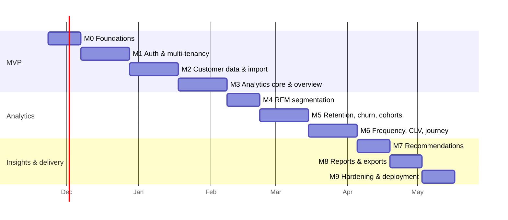

# 06 — Development Roadmap

Ten milestones. **M0–M3 make up the MVP**: a working, secure, multi-tenant app with customer data and a correct Business Overview. Advanced analytics come after, one module at a time. Each milestone ends with a demo on the synthetic dataset, green CI, and updated docs.

Rough sizing assumes one developer part-time (≈15–20 h/week). Scope follows the decisions in [01-srs.md](01-srs.md) §9.1: a portfolio project with production-grade foundations, so no SaaS billing, and compliance limited to GDPR-style design.

---

## M0 — Foundations (≈2 weeks)

**Functional requirements:** none user-facing. A developer can clone the repo and run the whole stack with one command.

**Technical implementation**

- Monorepo with pnpm workspaces: `apps/web`, `apps/api`, `services/analytics`, `packages/contracts`, `tools/datagen`.
- `docker-compose.yml` with `db`, `api`, `api-worker`, `analytics`, `web`; Postgres init script creating the `app_user` role.
- API skeleton: Express app, config validation, pino logging with request IDs, error middleware (problem details), `/health` and `/ready`.
- Prisma set up with the first migration (organizations, users, memberships) and the RLS helper SQL.
- Analytics skeleton: FastAPI `/internal/health`, psycopg pool, worker loop stub, Ruff + mypy + pytest.
- Web skeleton: Vite + React + TS + Tailwind + React Router + TanStack Query; app shell layout; ECharts wrapper component.
- CI (GitHub Actions): lint, typecheck, unit tests for all three apps; Docker build.
- ADRs for the decisions in [02-architecture.md](02-architecture.md) §2.

**Deliverables:** running skeleton, CI pipeline, `README` with setup steps, ADRs.

**Testing requirements:** smoke tests for health endpoints; CI runs on every push.

**Acceptance criteria**

- `docker compose up` brings up all services; `/ready` reports DB and analytics healthy.
- CI is green and fails on a lint or type error.
- A new developer gets the stack running from the README in under 15 minutes.

---

## M1 — Authentication, organizations and tenant isolation (≈3 weeks)

> **Status (2026-11-16): done.** Delivered as specified, with these notes: the access token's
> role can be up to 15 minutes stale (re-checked on every refresh); login rate limits use an
> in-memory store, so a shared store is needed before running several API instances (M9);
> member management and invitations stay in M8.

**Functional requirements:** AUTH-01, 02, 03, 07, 08, 09; PLT-01 (basic audit log).

**Technical implementation**

- Signup (user + organization + OWNER membership in one transaction), login, refresh with rotation and reuse detection, logout. Argon2id hashing.
- Auth middleware → `req.ctx`; role guard `requireRole('ADMIN', …)`.
- **Tenant-scoped Prisma client extension** + `set_config('app.org_id', …, true)` per request transaction; RLS policies on all tenant tables created so far.
- Organization settings endpoint with industry presets for `activeWindowDays` / `churnDays`.
- Rate limiting on auth routes; Helmet; CORS allow-list; CSRF double-submit for refresh.
- Web: signup (with industry picker that applies presets), login, logout, protected routes, silent refresh, settings page.
- i18n set-up (e.g. `react-i18next` with an English catalogue) and locale-aware formatting helpers for money, numbers and dates, so later UI strings are translatable from day one.

**Deliverables:** working auth flows, settings page, audit log table, **cross-tenant isolation test suite** (reusable helper that every later module adds its endpoints to).

**Testing requirements**

- Unit: token service (rotation, reuse detection, expiry), password policy.
- Integration (Testcontainers Postgres): every auth endpoint; role matrix.
- Isolation: with two organizations seeded, every endpoint called with org A's token on org B's IDs returns 404; a raw query with `app.org_id` unset returns zero rows.

**Acceptance criteria**

- A user can sign up, log in, stay logged in across access-token expiry, and log out.
- Reusing an old refresh token invalidates the whole session family.
- Isolation suite passes; disabling the Prisma extension in a test still yields no cross-tenant rows (RLS works on its own).
- Five failed logins in a minute return 429.

---

## M2 — Customer data management and CSV import (≈3 weeks)

> **Status (2026-11-16): done.** Notes on what changed from the plan:
>
> - CSV upload streams the raw file as the request body (`Content-Type: text/csv`) instead of
>   multipart; no upload library, and large files never sit in memory.
> - Writes bump `organizations.data_version`; enqueuing `analytics.recompute` waits for M3,
>   when a handler exists.
> - Demo data is generated by the Python worker (`analytics.demo_data`, `insights.datagen`), which
>   also has a CLI that writes import-ready CSVs plus a ground-truth file.
> - Money uses ISO 4217 minor units everywhere (ADR-0011).
> - Customer list statistics are computed per request from orders; M3 snapshots replace them.

**Functional requirements:** CUS-01, 02, 03, 04 (without segment), 05, 07, 08; PLT-02, PLT-03.

**Technical implementation**

- Prisma models and migrations: customers, orders, order_items, products, imports, jobs (+ raw SQL: generated `net_cents`, checks, partial and trigram indexes, RLS).
- Customer and order CRUD with Zod schemas shared via `packages/contracts`.
- Customer list: cursor pagination, search (trigram), filters, sorting.
- Customer profile: personal data + purchase history + **simple SQL aggregates** (order count, total spend, first/last order) as a temporary source until M3 snapshots exist.
- Postgres job queue (`SKIP LOCKED`) + Node worker; CSV import flow (upload → mapping → validation preview → commit, batched upserts, error CSV). `data_version` bump.
- `tools/datagen`: synthetic dataset generator (configurable size, industry profile, planted patterns); `POST /organization/demo-data`.
- Web: customers table, customer profile page, order forms, import wizard, job status.

**Deliverables:** customer and order management, import wizard, demo-data generator, CSV templates.

**Testing requirements**

- Unit: Zod schemas, CSV parsing (delimiters, BOM, date formats, decimal commas), mapping logic.
- Integration: CRUD endpoints, import idempotency (importing the same file twice changes nothing), error report correctness, job retry.
- Isolation suite extended to all new endpoints.
- E2E (Playwright): import a CSV and see the customers in the list.

**Acceptance criteria**

- 100k-row order CSV imports in under 3 minutes without blocking API requests.
- Re-importing the same file creates no duplicates.
- Invalid rows are rejected with row number, column and reason; valid rows still import.
- Customer profile shows correct totals for a hand-checked fixture.

---

## M3 — Analytics core and Business Overview (≈3 weeks) — **MVP complete**

> **Status (2026-11-16): implemented.** Notes on what changed from the plan:
>
> - `GET /analytics/overview` returns KPIs and the revenue and acquisition series in one response;
>   `GET /analytics/status` replaces the separate runs and data-quality endpoints.
> - Nightly runs are self-scheduling: each successful recompute queues the next one for 02:00 in
>   the organization's time zone, so no cross-tenant scheduler query is needed.
> - Edits schedule a recompute 10 minutes out; imports, settings changes and "Recompute now" run
>   immediately. One pending recompute per organization is the debounce.
> - The customer list and profile keep their live per-request statistics; snapshot metrics
>   (lifecycle status, gaps, frequency) feed segmentation in M4.
> - "Customer since" (for Total customers) is the earliest of registration and first purchase, so
>   imported historical customers are not counted from the import date.

**Functional requirements:** OVR-01 … 05, OVR-06 (date range), OVR-07; ANA-07 (historical CLV); ANA-09; RPT-01, RPT-07.

**Technical implementation**

- Python: data loader (SQL aggregates → typed DataFrames), cleaning step + data-quality report, metric registry (YAML) with versions.
- Metrics v1: total/active/new/returning customers, buyers, revenue, orders, AOV, purchase frequency, retention rate, churn rate, historical CLV, lifecycle status (methodology §4–5).
- `analytics.recompute` job: writes `analytics_runs`, `analytics_customer_metrics`, `analytics_period_metrics`. Triggers: import completion, debounced data changes, nightly schedule, manual.
- On-demand `/internal/query/overview` for custom ranges + `analytics_query_cache` keyed by `data_version`.
- API `analytics` facade module; customer profile switches to snapshot metrics.
- Streamed customer CSV export with CSV-injection escaping; audit entry.
- Web: Overview page (KPI cards with deltas and definition tooltips, revenue trend, acquisition trend, date-range and comparison picker, "computed at" + Recompute), methodology page v1 from `/analytics/definitions`.

**Deliverables:** Business Overview dashboard, analytics service with first metric set, metric registry, customer export.

**Testing requirements**

- Golden fixtures for every metric, including DST, period edges, refunds, guest orders.
- Property tests (Hypothesis) for invariants.
- SQL vs Pandas cross-check for overview KPIs.
- E2E: demo data → overview shows the expected KPIs for the planted dataset.

**Acceptance criteria**

- Every KPI matches its golden fixture exactly.
- Overview loads in under 500 ms (p95) from cache/snapshot for the 100k-customer demo tenant.
- Every KPI tooltip shows definition, period and as-of date.
- A data change is reflected in the overview within 15 minutes, or immediately after Recompute.
- **MVP product acceptance** ([01-srs.md](01-srs.md) §8) is met.

---

## M4 — RFM segmentation (≈2 weeks)

> **Status (2026-11-16): implemented.** Notes on what changed from the plan:
>
> - The configuration chooses thresholds or quintiles per dimension. Recency thresholds are the
>   organization's `recencyCutPoints` setting; frequency (minimum orders for scores 2–5) and
>   monetary thresholds live in the configuration. Default: recency and frequency by
>   thresholds, monetary by quintile.
> - Every organization gets version 1 at signup; the migration backfilled existing ones.
>   Saving creates a new version and recomputes immediately.
> - The R × F matrix is part of `GET /segments` (no separate endpoint).
> - Segment filters (customer list, Overview) use the latest successful snapshot; the Overview
>   cache key includes that snapshot's ID, so a new run never serves stale membership.

**Functional requirements:** SEG-01 … 04, SEG-06, SEG-07; CUS-04 (segment on profile); OVR-06 (segment filter).

**Technical implementation**

- `segment_configs` with versioning; default config seeded per organization (industry preset thresholds).
- Python `rfm.py`: raw R/F/M, quintile and fixed-threshold scoring, ordered rule evaluation, coverage validation; written into `analytics_customer_metrics`.
- `/segments`, `/segments/matrix`, config CRUD, `/segments/config/preview` (dry run).
- Segment filter on overview and customer list.
- Web: Segments page (summary cards, share-of-revenue bar, R×F heat map), configuration editor with preview, segment badge on customer list/profile.

**Testing requirements:** golden RFM fixture (ties, F=0 customers, no-order customers); property test that every scored customer gets exactly one segment; config validation tests.

**Acceptance criteria**

- Segments of the golden fixture match the hand-computed expectation.
- Editing rules and previewing shows new counts without saving; activating triggers a recompute and records the config version on the run.
- Methodology page documents the active configuration.

---

## M5 — Retention, churn and cohort analysis (≈3 weeks)

> **Status (2026-11-16): implemented.** Notes on what changed from the plan:
>
> - One Behavior page (`/analytics`) with Retention, Churn and Cohorts tabs instead of three
>   pages; period, grain and segment filters; CSV download for every chart and the churn list.
> - Cohort cells are computed on read (cached by data version), not stored in
>   `analytics_cohort_cells`. One response carries all three views, so the toggle needs no request.
> - Churn by segment uses each customer's segment the day before the range, recomputed with the
>   active rules: the latest snapshot's segment would mostly say "Lost" for churned customers.
> - The recommended grain is month or quarter (median gap > 60 days → quarter); weekly is
>   available but never recommended.
> - Planted churn wave: the datagen end-to-end test asserts the wave cohort has the lowest
>   1–3-month retention of its neighbours; in the demo tenant it shows as ~4% vs ~35%.

**Functional requirements:** ANA-01, 02, 03, 10; ANA-08 (CSV for these charts).

**Technical implementation**

- Python: retention time series (grain-aware), churn time series + churned-customer list + reactivations, cohort cells, Wilson intervals, low-sample warnings, recommended grain from median gap.
- Endpoints `/analytics/retention`, `/analytics/churn`, `/analytics/churn/customers`, `/analytics/cohorts`.
- Web: Retention page (line chart with confidence band), Churn page (rate + breakdown by segment + list), Cohort heat map (retention / revenue per customer / cumulative toggle), segment and date filters.

**Testing requirements:** golden fixtures for retention, churn (including delayed recognition and reactivation) and cohorts (incomplete cells are null); datagen end-to-end test that a planted churn wave appears in the expected month.

**Acceptance criteria**

- Cohort matrix matches the fixture; incomplete cells show as "not yet available".
- The planted churn wave is detected in the right period.
- Tooltips explain why churn rate ≠ 1 − retention rate.

---

## M6 — Purchase frequency, CLV, journey and engagement (≈3 weeks)

> **Status (2026-11-16): implemented.** Notes on what changed from the plan:
>
> - One Customer value page (`/value`) with Frequency, Lifetime value, Journey and Engagement tabs
>   instead of four pages; acquisition-window and segment filters; CSV for the main tables.
> - Frequency counts purchase occasions (same-day orders merged) everywhere, so the histogram,
>   repeat rate and time to second purchase agree. Kaplan–Meier is a small in-house estimator,
>   tested against `lifelines` reference output rather than adding `lifelines` (and SciPy) as a
>   dependency.
> - CLV by cohort uses 90/180/365-day horizons from each customer's first purchase, null until
>   the whole cohort has had that long; everything is `kind: "measured"`.
> - Engagement weights live in organization settings (editable in Settings) rather than a separate
>   versioned table; responses echo the weights used. Scores are stored in the nightly snapshot.
> - Interactions gained an optional `external_id` (unique per organization) so batches and CSV
>   imports are idempotent. Demo data now includes interactions that precede purchases.

**Functional requirements:** ANA-04, ANA-07 (cohort CLV views), ANA-05, ANA-06, CUS-06 — scope of ANA-05/06 depends on [OPEN-4]/[OPEN-5].

**Technical implementation**

- Python: order-count histogram, repeat purchase rate, inter-purchase gaps (occasion merging), Kaplan–Meier time-to-second-purchase, CLV by cohort (12-month) and by segment, lifecycle funnel, engagement score (configurable weights).
- Interactions CRUD + batch endpoint + CSV import entity.
- Web: Frequency page, CLV page, Journey funnel, Engagement page; interaction timeline on customer profile.

**Testing requirements:** fixtures for gaps (same-day orders), Kaplan–Meier against `lifelines` reference output, engagement score determinism.

**Acceptance criteria**

- Time-to-second-purchase uses censoring-aware estimates; the UI discloses censoring.
- All CLV figures are labeled measured; no predictive CLV appears yet.

---

## M7 — Recommendation engine (≈2 weeks)

> **Status (2026-11-16): implemented.** Notes on what changed from the plan:
>
> - Rules run inside the recompute job's write transaction (not a separate job), and each rule is
>   isolated: a failing rule is logged in the run's stats and the others still run.
> - The lifecycle is a pure `reconcile` step (tested without a database) applied by `save`.
>   Recommendations gained `missed_runs` (expiry after two runs), `status_revenue_cents` and
>   `status_changed_at` (the 90-day dismissal cooldown and its +50% exception); done ones reopen
>   after 30 days.
> - The datagen now plants "quiet VIPs" (a quarter of VIPs stop buying 60–150 days before the
>   end, from their own random stream); the end-to-end test asserts ≥ 80% of them are flagged.
> - The rule text is generated in English by the analytics service; the UI translates rule
>   names, statuses, priorities and metric labels.

**Functional requirements:** REC-01 … 05.

**Technical implementation**

- Python `recommendations/`: rule interface (`evaluate(snapshot, config) → list[Finding]`), the six rules in methodology §10, priority scoring, fingerprint upsert, expiry and dismissal cooldown. Runs as the last step of `analytics.recompute`.
- Two-proportion z-test helper for `retention_decline`.
- API: list, detail, status update, affected customers (+ CSV).
- Web: Recommendations inbox (priority, filters), detail view with supporting metrics and a chart, status actions, link to affected customers; top-3 recommendations on the overview.

**Testing requirements:** unit test per rule (fires / does not fire at threshold boundaries); lifecycle tests (dedup, expiry, dismissal cooldown); datagen test that planted high-value at-risk customers trigger `churn_risk_high_value`.

**Acceptance criteria**

- Every recommendation shows opportunity, supporting metrics, explanation, action and priority.
- No duplicate open recommendations per fingerprint across repeated runs.
- A dismissed recommendation does not reappear within 90 days unless revenue at stake grows ≥ 50%.

---

## M8 — Reports, exports and collaboration (≈2 weeks)

> **Status (2026-11-18): implemented.** Notes on what changed from the plan:
>
> - PDF reports are rendered by PDFKit in the Node worker (`report.pdf` job), not by a headless
>   browser or WeasyPrint: no browser or system fonts in the images. Charts are simple drawn bars;
>   text is mapped to the PDF fonts' Latin-1 encoding.
> - Emails go through a `Mailer` interface (nodemailer SMTP; Mailpit in docker compose at
>   http://localhost:8025). Without `SMTP_URL` emails are dropped with a log line, never logged
>   with their links. Sending is inline; a failed invitation email is reported (`emailSent: false`).
> - Invitations keep row-level security: public acceptance sets `app.invitation_token` to the
>   token hash, which makes exactly that row visible. Password-reset tokens, like refresh tokens,
>   are user-level and not RLS-protected.
> - Team management (members, roles, invitations) is its own page (`/team`); owners stay
>   protected from admins and an organization always keeps one owner.
> - Comparison parameters are flat (`aStart`, `aEnd`, `bStart`, `bEnd`) and there is a CSV
>   version; an orders export was added next to the customers one.

**Functional requirements:** RPT-02, 03, 04, 05; ANA-08 complete; AUTH-04, 05, 06 (invitations, org switching, password reset).

**Technical implementation**

- KPI CSV export, chart-data CSV export for every analytics endpoint, period comparison report.
- PDF report job (server-side rendering, e.g. Playwright printing a report route, or WeasyPrint in Python).
- Email via SMTP abstraction (Mailpit locally); invitations, password reset, organization switcher.

**Testing requirements:** comparison report math; CSV formatting (BOM, escaping, locale); invitation and reset token expiry; PDF job produces a file.

**Acceptance criteria**

- A user can compare two periods for a segment and export the result.
- An invited user joins with the assigned role; an expired invitation is rejected.

---

## M9 — Hardening, performance and deployment (≈2 weeks)

**Technical implementation**

- Load test (k6) at A1 volume; query tuning (EXPLAIN), index review; snapshot retention/pruning job.
- Security review: dependency audit, OWASP checklist, secret handling, RLS review on every table, penetration-style tests of isolation.
- Observability: structured logs shipped, basic metrics (request latency, job durations, failures), alerts on failed runs.
- Production Docker images (multi-stage, non-root), deployment to a PaaS (Render, Railway or Fly.io; chosen here) with managed Postgres, backups and HTTPS. The analytics service runs as a private service with no public URL.
- Privacy: customer anonymization (CUS-10), organization data export and deletion, retention policies ([OPEN-8], [OPEN-11]).
- Accessibility audit (axe) and fixes.

**Acceptance criteria**

- NFR-PERF targets met in the load test.
- No high or critical findings from dependency audit and security checklist.
- Production deployment reachable over HTTPS with backups verified by a restore test.

---

## Later (P2 backlog)

Predictive CLV with backtesting; segment migration Sankey; rule tuning UI; scheduled email reports; integrations (Shopify, Stripe, WooCommerce); subscription/contractual churn and MRR; SSO; customer merge; product affinity / basket analysis.
